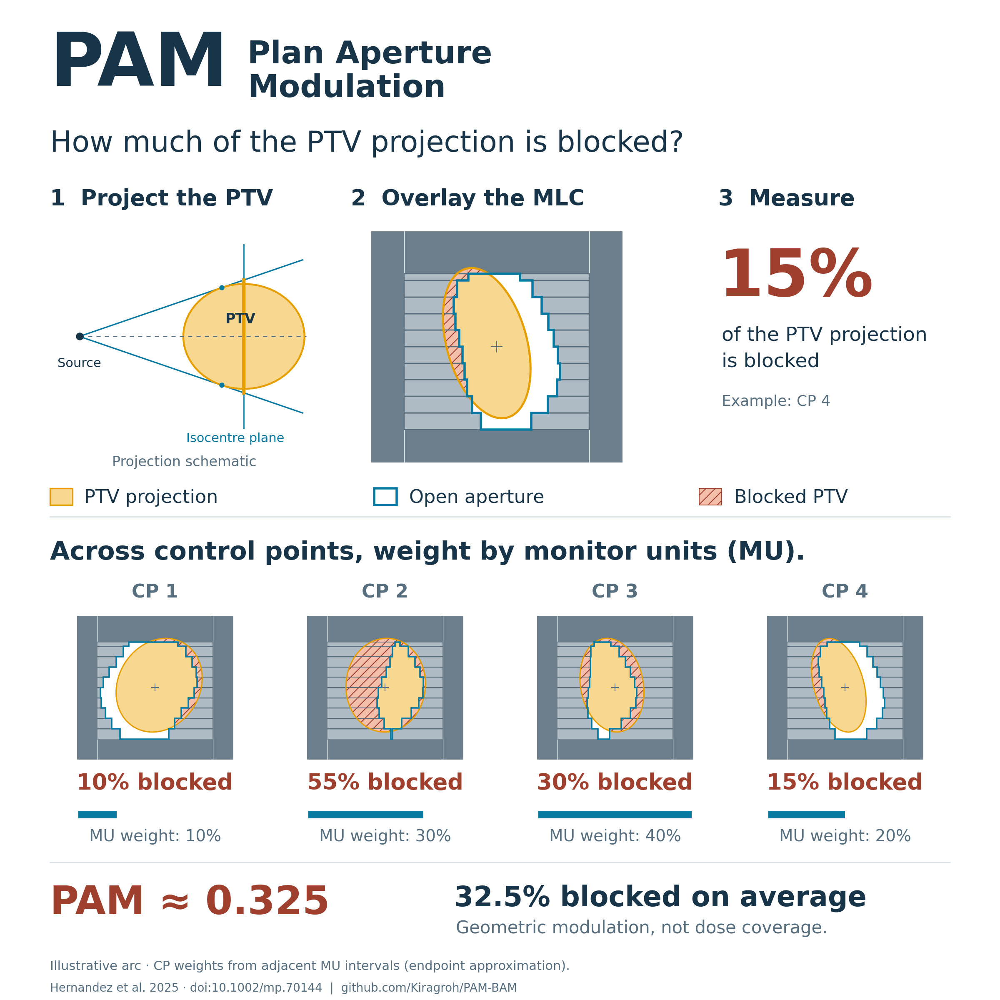
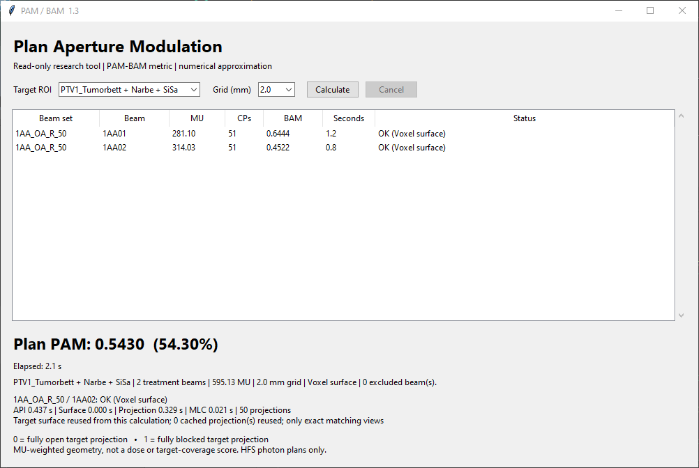
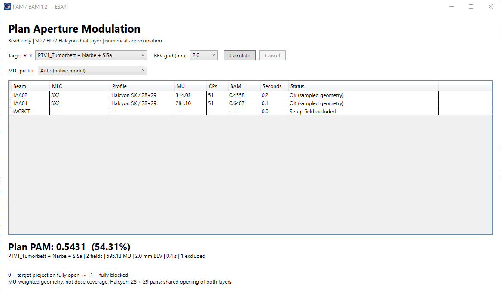

# PAM and BAM — understand aperture modulation

**How much of the target projection is hidden by the MLC or jaws?**

Plan aperture modulation (**PAM**) describes this geometrically across a
treatment plan. At each control point, project the selected target into the
beam's-eye view, find the fraction outside the open aperture, then combine
those fractions using monitor-unit (**MU**) weights. Beam aperture modulation
(**BAM**) applies the same idea to one beam.

**PAM = 0.40 means that, on an MU-weighted average, 40% of the selected target's
projection is blocked by the collimation system.** It does not mean that 40%
of the target volume receives no dose.



*Synthetic example with one arc: 10%, 55%, 30% and 15% blocked, weighted by
10%, 30%, 40% and 20% of the MU, give PAM = BAM ≈ 0.325. The weights use the
endpoint approximation described in the [worked example](docs/method.md#worked-example-one-arc-four-control-points).
[Full-resolution vector figure](docs/images/pam-explained.svg).*

This repository implements the published metrics of
[Hernandez et al. (2025)](https://doi.org/10.1002/mp.70144) in Python and C#,
with read-only GUIs for **RayStation** and **Eclipse / ESAPI**, plus reusable
geometry functions. Single-layer and dual-layer MLCs are supported explicitly.

[Use in your TPS](#use-in-your-tps) · [Interpret the result](#interpret-the-result) ·
[Python quick start](#python-quick-start) · [Method](docs/method.md) ·
[Verification](docs/verification.md)

## Interpret the result

| Value or concept | Meaning |
|---|---|
| **AM** | Blocked fraction of the selected target projection at one sample |
| **BAM** | MU-weighted AM for one beam |
| **PAM** | MU-weighted BAM across all treatment beams, for the same target |
| **0 → 1** | From a fully open target projection to a fully blocked target projection at all weighted samples |
| **Dual-layer MLC** | A point is open only where **both layers are open**, subject to jaws or fixed field limits |

**Why does the target matter?** PAM compares the opening with the selected
target's projected shape. The same leaf sequence can therefore produce
different values for different targets. Keep target selection consistent when
comparing plans; for multiple target dose levels, evaluate each target separately.

**What is it useful for?** Describing and comparing target-relative aperture
modulation, examining individual beams, and studying its relationship with
other plan or QA measures. A higher value means more geometric blocking; it
does not by itself establish worse plan quality, harder delivery or a failed
patient-specific QA result. PAM does not calculate dose coverage, leaf speed,
transmission or delivery accuracy. This repository provides no clinical
accept/reject threshold or validated PSQA prediction.

## Use in your TPS

Choose the standalone script for your TPS. These GUIs read the open plan and
selected target; they do not save or modify the plan or export patient data.

| TPS | Download the single-file script | Start here |
|---|---|---|
| **RayStation** | [PAM_BAM.py](scripts/raystation/PAM_BAM.py) | [RayStation setup and scope](scripts/raystation/README.md) |
| **Eclipse / ESAPI** | [PAM_BAM.cs](scripts/esapi/PAM_BAM.cs) | [Eclipse setup and MLC profiles](scripts/esapi/README.md) |

1. Open a supported photon plan and run the script in the TPS scripting environment.
2. Select the target ROI and BEV grid spacing; the default is **2.0 mm**.
   In Eclipse, also check the MLC profile: Auto, TrueBeam SD, TrueBeam HD or Halcyon SX.
3. Select **Calculate** to see BAM per treatment beam and the MU-weighted plan PAM.
   Setup and zero-MU beams are excluded. A failed treatment beam prevents a
   misleading partial plan result.

RayStation requires **NumPy and Tkinter** in its CPython environment; the
repository package is not needed. The Eclipse GUI runs as a single-file
ESAPI plug-in without other repository source files or NuGet packages.
Read the TPS-specific guide for supported geometry and local validation.

### RayStation 2024 — GUI 1.3



*Author-provided example: 2.0 mm grid, PAM 0.5430, 2.1 s total.*

### Eclipse / ESAPI — GUI 1.2



*Author-provided example: 2.0 mm grid, Halcyon SX 28+29, PAM 0.5431, 0.4 s total.*

These screenshots document individual successful runs reported by the author.
They are not universal timing benchmarks or a cross-TPS validation study.
The [verification record](docs/verification.md) separates synthetic tests,
compilation checks and reported TPS runs.

## Definitions and implementation

For target silhouette `T` and effective opening `O` in the same isocentre plane:

```text
AM  = 1 - area(T intersect O) / area(T)
BAM = sum(AM_j * MU_j) / sum(MU_j)                 [one beam]
PAM = sum(BAM_b * MU_b) / sum(MU_b)               [same target, all beams]
```

Dual-layer openings are intersected using the actual leaf boundaries and
offsets. A bounding box is not a substitute for the target silhouette.
The [method guide](docs/method.md) explains the numerical sampling, units,
single/dual-layer geometry and differences in TPS weight inputs.

## Python quick start

Python 3.8 or later, standard library only at runtime. Put this repository on
the script's Python path, or install locally with `python -m pip install .`.
This project is not published to PyPI; do not assume `pip install pambam` fetches it.

```python
from pambam import Layer, dual_layer_aperture, bam_from_control_points, calculate_pam

# Entirely synthetic geometry, not a commissioned Halcyon profile.
upper = Layer((-10, 0, 10), (-10, -10), (10, 10))
lower = Layer((-15, -5, 5, 15), (0, -5, 0), (5, 5, 5))
opening = dual_layer_aperture(upper, lower)
target = [(-10, -10, 10, 10)]
beam = bam_from_control_points([target, target], [opening, opening],
                               [0, 1], 100, 'synthetic-target')
assert abs(beam.bam - 0.625) < 1e-12
assert abs(calculate_pam([beam]) - 0.625) < 1e-12
```

Run `python -m examples.synthetic` for a two-beam example.

## TPS adapters and what still needs local integration

The following are **library adapters**, distinct from the standalone GUIs above. Neither adapter
creates a patient context, writes a structure, launches a process, saves a plan,
nor calculates the 3D target silhouette automatically. A site-validated target
projection provider at every control point is required. This boundary is
deliberate: a beam-start outline must not be reused throughout a rotating arc.

| Adapter | Native input and explicit requirements |
|---|---|
| [ESAPI C#](csharp/EsapiAdapter.cs) | Reads `ControlPoint.LeafPositions`, `JawPositions`, `MetersetWeight` and beam meterset in MU on the owning STA. An exact MLC profile maps all native leaf indices once to one or two layers. Caller supplies a validated target-BEV provider. |
| [RayStation Python](pambam/raystation.py) | Reads `BeamMU`, `Segments`, `LeafPositions` and, only when configured, `JawPositions`. Converts native cm to mm; dual banks 0/1 and 2/3. Caller supplies leaf boundaries, target provider and an explicit validated cumulative-CP or sample-MU sequence. |

For ESAPI, include `csharp/PamBam.cs` and `csharp/EsapiAdapter.cs` in your existing
read-only ESAPI project and reference your installed vendor assemblies. The core
uses framework-compatible C# syntax; the **test runner** uses .NET 10. The adapter
was compiled against ESAPI 16.1 locally, but live TPS execution is not validated.

For RayStation, see [integration notes](docs/tps-integration.md). The adapter's
bank/length contract was checked against the v2025 SP2 scripting documentation
and tested with synthetic objects. The library adapter itself was **not run in RayStation**; the standalone GUI
has the user-reported run described above. API availability,
projection frames, machine profiles and segment/CP weights require local validation.

## Tests and verification

```text
python -m unittest discover -s tests -v
python -m unittest discover -s scripts/raystation/tests -v
dotnet run --project csharp/tests/PamBam.Tests.csproj
```

Tests use synthetic geometry and cover target unions, staggered layers, unit
conversion, MU weighting and invalid inputs. The RayStation suite also checks
projection parity and cache behavior. See [verification](docs/verification.md)
for the recorded results, GUI-specific checks and limitations. Synthetic tests
and successful application runs do not constitute clinical commissioning.

## References and related tools

**Metric source:** Hernandez V, Lara-Aristimuño I, Abella R, Saez J.
*Quantification of the aperture modulation in radiotherapy treatment plans.*
Medical Physics. 2025;52(12):e70144.
[doi:10.1002/mp.70144](https://doi.org/10.1002/mp.70144).
Equations 1–2 define AM and PAM; Section 2.2 also describes beam-level BAM.
Please cite the original paper when using these metrics. The authors have not
endorsed or validated this implementation.

**Related independent resource:** [RTplan Complexity Lens metrics](https://rt-complexity-lens.lovable.app/metrics)
and its [source repository](https://github.com/matteomaspero/rt-complexity-lens).
Linked for comparison/discovery, not used as a numerical oracle or runtime service.
No code, screenshots, or data from that project are bundled here; numerical
equivalence has not been established. Never upload clinical data without approval.

## License and safety

MIT for this repository's original source; see [LICENSE](LICENSE).
The publication and linked projects retain their own licenses.
No treatment decisions, QA replacements, auto-approval or clinical safety claims.
Review target selection, all treatment beams, units, layer assignment, projection
convergence and sampling against independent local reference cases before use.
